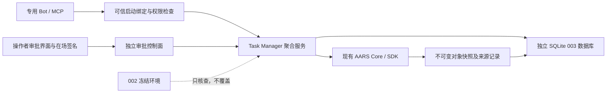

# WP-02 Task Manager 元模型

Task是管理聚合，放在未来独立aars_task_manager适配层，不向Core ObjectType塞入TASK，也不把Task伪装为Observation或Evidence。复用现有AARSClient构造/认证对象、object_from_dict反序列化、Core Provenance和图引用校验；Task状态与Core ObjectStatus分别维护。旧SDK默认ACTIVE/ACCEPTED状态不能成为任务审批依据。

|对象|身份及必填|版本/生命周期|关系与完整性|
|---|---|---|---|
|Workspace|workspace.<32hex>，mode=LOCAL_SYNTHETIC或CATALOG_METADATA，policy_version|配置变更由操作者，归档不复用ID|1:N Task、PrincipalBinding；不得跨环境复用DB实例ID|
|Task|task.<32hex>，workspace_id,title,purpose,owner_principal_id,state,version,definition_revision,definition_hash,created_at,updated_at|version从1逐事件+1；定义变化另增definition_revision；无硬删除|1:N revision/event/attempt/review/link；owner为已启用BOT绑定；priority可选0～5，due_at可选UTC|
|TaskRevision|task_id+version，完整管理快照、snapshot_hash、event_id|追加不可变；不保存密钥；状态不是业务对象状态|与事件和Task当前version一致；用于审计和回放核验|
|PrincipalBinding|principal.<32hex>，kind、binding_id、host_bot_id、capabilities、active、binding_version|操作者配置，撤销立即生效|Bot身份来自服务启动绑定，不能来自工具参数或clientInfo|
|ExecutionAttempt|attempt.<32hex>，task_id,attempt_no,actor,fencing_token,lease_expires_at,status|ACQUIRED/RUNNING/SUBMITTED/PAUSED/FAILED/EXPIRED/CANCELLED；每次启动新attempt|Task至多一个活动attempt；fencing_token单任务严格递增；不代表生产执行能力|
|TaskEvent|event.<32hex>，task_id,seq,event_type,actor,time,from/to版本与状态,payload_hash,prev_hash,event_hash|追加，不修改；首事件prev_hash为64个0|task_id+seq唯一；版本链连续；哈希链不抵抗持有DB写权限的同用户恶意重写|
|ObjectSnapshot|sha256:<64hex>为snapshot_id，Core object_id/type、完整canonical bytes、graph_digest、来源核验级别|同ID不同内容保留不同快照，并显式标记supersedes；旧快照不可覆盖|不是新Core类型；复用现有对象，完整引用闭包须通过Core认证|
|TaskEvidenceLinkVersion|link.<32hex>+revision，task_id,snapshot_id,scope,purpose,source_verification,license_basis,use_state|追加版本；USABLE_FIXTURE/REVIEW_REQUIRED/UNUSABLE/REVOKED|只能关联Core Evidence；Observation不能自动提升为Evidence；用途不得超Task目的|
|ReviewRequest|review.<32hex>，task_id,subject_version,definition_hash,evidence_set_hash,attempt_id,status,expires_at|PENDING/APPROVED/REJECTED/CHANGES_REQUESTED/STALE/EXPIRED|绑定确定版本与证据集合；一个Task至多一个PENDING；Bot只能提交请求|
|ApprovalDecision|approval.<32hex>，review/challenge、decision、签名receipt、signer_key_id、policy_version、reason,time|不可变，撤销另记事件；只接受可信人工控制面|每个challenge至多一项决定；Bot建议不得写入此对象|
|IdempotencyRecord|workspace_id+principal_id+key，method、request_hash、original_response、result_version|永久或随工作区归档保留tombstone；不静默过期后重放|同key不同请求拒绝；成功回放不重复状态转换；权限撤销优先于回放|

所有管理ID服务端生成，ID不可当权限。UTC RFC3339 Z、微秒精度；版本排序和事件seq定义先后，不依赖墙钟唯一性。created_at不可变，updated_at不得倒退；过去due_at仅提示逾期，不自动执行/批准。任务标题1～200字，说明最多4000字；自由文本始终是不可信数据。

定义版本只含title/description/purpose/owner及scope等可审查内容；state/lease等运行字段只改变Task.version。变更定义会撤销未使用的计划许可、使待审批快照STALE；RUNNING/REVIEW_PENDING不允许修改定义，必须先由操作者退回DRAFT并收回活动租约。终态保留完整历史，不直接重开；需新Task+supersedes_task_id。

授权与质量不混同：结构符合、存储哈希一致、来源真实性、用途许可、人工接受分别记录。当前只允许固定测试对象或目录元数据；数据资源PENDING不得借Task关联进入研究证据链。不创建真实观测或研究结论，不自动把Claim变为Knowledge。

## 规范化记录与任务级授权补充

规范化TaskRecord总是包含priority（默认3）、due_at（缺省null）、supersedes_task_id（缺省null），因此JSON Schema把这些字段设为必填但允许null；输入可省略。任务不实现tags字段。schema中的Workspace、TaskRevision、ObjectSnapshot、ApprovalDecision、IdempotencyRecord和TaskAcl与表中对象一一对应；ApprovalReceipt是控制面传输值。

TaskAcl以workspace+task+principal+permission确定身份，操作者在DRAFT/PAUSED通过签名CONTROL决定授予/撤销READ/PROPOSE/WORK；owner有隐式本任务权限，WORK不含DRAFT定义编辑或批准。授权变化追加事件并递增Task.version，更新authorization_scope_hash，旧review失效。默认无额外ACL，不因同一机器存在多个Bot自动协作。

Task字段中的description/priority/due_at均属于定义hash；RUNNING/REVIEW_PENDING不允许定义编辑；受控变更owner/purpose/scope需先回DRAFT并重新批准计划。计划许可只绑定确定定义和范围，不是任意外部执行许可。

Task.scope由服务根据绑定工作区和purpose派生，必填workspace_id、data_mode和external_execution_allowed=false；不接受Bot传scope。LOCAL_SYNTHETIC_VALIDATION只能SYNTHETIC_ONLY，CATALOG_METADATA只允许目录元数据，Task.scope.workspace_id必须等于Task.workspace_id。定义hash覆盖该scope，授权hash覆盖其有效ACL/策略。

当前可运行验收轨迹仅LOCAL_SYNTHETIC_VALIDATION。CATALOG_METADATA保留为不可执行目录草稿，仅允许DRAFT创建/读取/编辑/取消，不允许approve_plan、start、关联研究Evidence或完成研究任务；该限制不能被人工签名绕过。后续开放新用途需另行评审，不在003B默认授权中。

Task.usage_state是交付可使用状态，不是执行授权：创建和非终态默认REVIEW_REQUIRED，人工批准结果且来源/用途仍有效后才置USABLE；许可失效再改回REVIEW_REQUIRED/UNUSABLE。READY只表示计划获准的本地合成流程可开始，execution_authorized仍为false，不授予生产执行。
