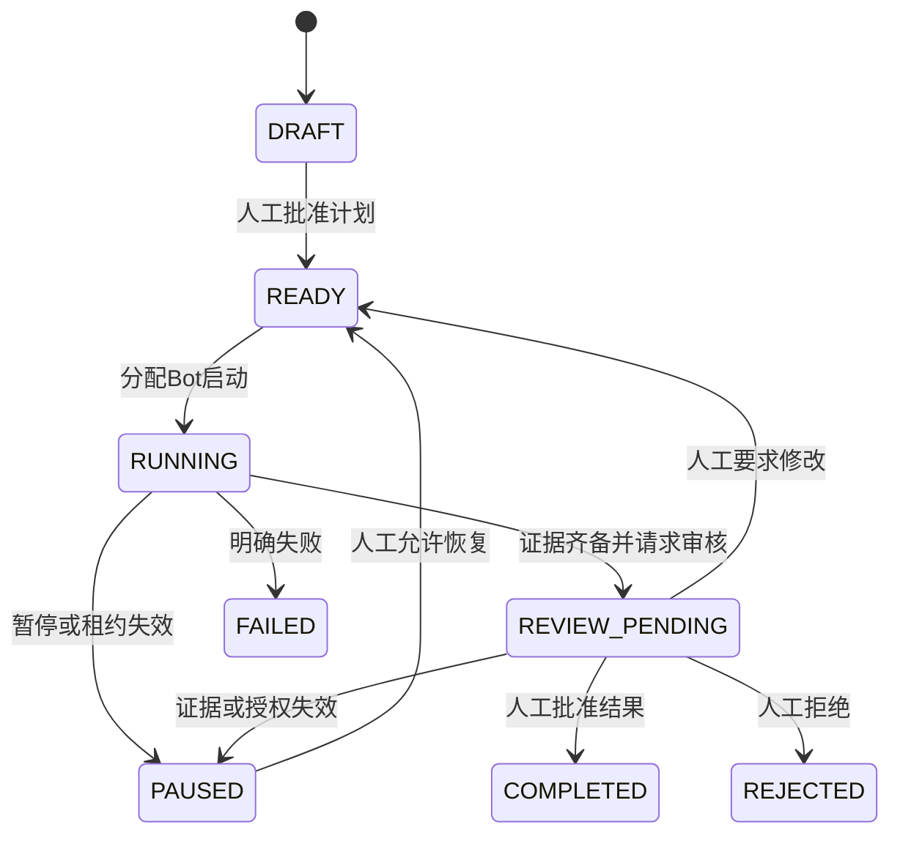

# WP-03 默认拒绝状态机

唯一允许转换列于STATE_TRANSITIONS.json。所有未列出的源状态/动作/主体组合均返回INVALID_TRANSITION或FORBIDDEN，不变更任务版本。不存在任意set_state、强制完成或自动批准入口。

|源状态|动作|目标|主体与前置条件|
|---|---|---|---|
|无|create|DRAFT|允许创建的Bot；绑定Workspace，服务端version=1|
|DRAFT|approve_plan|READY|人工签名；当前定义hash/版本/用途均相符|
|DRAFT|cancel|CANCELLED|操作者；或策略允许的owner Bot|
|READY|start|RUNNING|获分配Bot；期望版本正确、无活动attempt、创建新租约|
|READY|return_to_draft|DRAFT|人工签名；使计划许可失效|
|READY|cancel|CANCELLED|操作者或可取消owner|
|RUNNING|pause|PAUSED|当前租约Bot或人工；结束活动attempt|
|RUNNING|request_review|REVIEW_PENDING|当前租约Bot；至少1个可用Evidence；完整性和用途验证通过|
|RUNNING|fail|FAILED|当前租约Bot或恢复服务；失败原因必填|
|RUNNING|cancel|CANCELLED|人工；或明确允许且持有效租约的owner|
|RUNNING|lease_expired|PAUSED|恢复服务；attempt=EXPIRED，不自动重跑|
|PAUSED|resume_authorize|READY|人工签名；重新核查目的与授权|
|PAUSED|return_to_draft|DRAFT|人工签名；无活动attempt|
|PAUSED|cancel|CANCELLED|人工或可取消owner|
|REVIEW_PENDING|approve_result|COMPLETED|人工在场签名；review snapshot完全匹配、未过期|
|REVIEW_PENDING|reject_result|REJECTED|人工在场签名；原因必填|
|REVIEW_PENDING|request_changes|READY|人工在场签名；关闭本次review；下一次新attempt|
|REVIEW_PENDING|review_invalidated|PAUSED|恢复/校验服务；来源、许可、绑定或证据状态变化|
|REVIEW_PENDING|cancel|CANCELLED|人工在场签名|

COMPLETED、REJECTED、FAILED、CANCELLED是终态，无出边。COMPLETED后许可撤销，保留state和原决定，追加TASK_USABILITY_CHANGED事件并设置usage_state=REVIEW_REQUIRED；不静默删除、也不把历史批准改写成未批准。

同状态操作：普通update只允许DRAFT；link_evidence只允许RUNNING且租约有效；lease_renew只允许RUNNING。它们均通过CAS增加version与事件seq，即使state不变。只读不增版本；相同幂等键回放不增版本。无变化的PATCH拒绝NO_CHANGE，避免无意义事件。

租约：默认60秒，30秒前续租，单次延长≤60秒；任务最长连续运行由操作者策略限制，默认15分钟。每次新attempt递增fencing_token；过期后迟到写入拒绝LEASE_EXPIRED/FENCING_CONFLICT。重启时废弃所有上次进程的活动租约，RUNNING转PAUSED；不会因“之前正在运行”直接推断成功。

图只显示主路径，完整允许集以表和JSON为准。恢复/授权变化只能执行明确列出的服务动作，不能借“恢复”绕过人工门。

同状态服务动作补充：PLAN/CONTROL review在重启/超时失效时追加review_challenge_invalidated事件并增version；RESULT走已列出的review_invalidated边。缺少人工在场机制时approve_plan/approve_result/reject_result等始终拒绝，不以模拟receipt推进状态。

purpose全局guard：CATALOG_METADATA仅DRAFT目录管理，approve_plan返回PURPOSE_NOT_EXECUTABLE；因此允许边表仍需满足purpose约束，不能只看人工角色。所有示例执行轨迹使用LOCAL_SYNTHETIC_VALIDATION。
